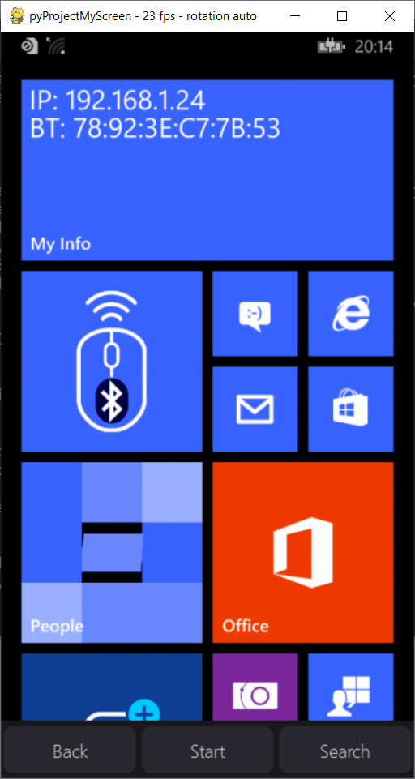

# pyProjectMyScreen

Python replacement for Microsoft's *Project My Screen* (`ProjectMyScreenApp.exe`): shows the
screen of a Windows Phone 8.1 device (Lumia 520) connected by USB and sends touch input and the
hardware buttons back to the phone.

Protocol: see [`Lumia520/content/drivers/ufnvidstream.md`](https://github.com/fredericGette/Lumia520/blob/main/content/drivers/ufnvidstream.md) and [`Lumia520/content/libraries/vidstream.md`](https://github.com/fredericGette/Lumia520/blob/main/content/libraries/vidstream.md).



## Requirements
- Windows. The script talks to the phone through `setupapi.dll` and `winusb.dll`.
- The phone's VidStream interface must be bound to WinUSB. It already is if the official
  *Project My Screen* app works on this PC.
- Python 3.10 or newer ([python.org](https://www.python.org/downloads/windows/)). Tick
  "Add python.exe to PATH" in the installer.

## Installation
1. Open a terminal (PowerShell or cmd) in the project folder.
2. Optional: create and activate a virtual environment:
   ```
   python -m venv .venv
   .venv\Scripts\activate
   ```
3. Install the dependencies (pygame-ce and numpy):
   ```
   python -m pip install -r requirements.txt
   ```
   pygame-ce is used instead of pygame because pygame 2.6.1 has no prebuilt package for
   Python 3.14. Don't install both, since they share the `pygame` module name. If `pygame` is
   already installed, remove it first with `python -m pip uninstall pygame`.
4. Optional: check the installation without a phone:
   ```
   python pyprojectmyscreen.py --selftest
   ```
   It prints `selftest OK` if everything works.

## Starting the script
1. Close the official *Project My Screen* app. Only one program can open the device at a time.
2. Connect the phone by USB and unlock it.
3. Start the script (activate the virtual environment first if you created one):
   ```
   python pyprojectmyscreen.py
   ```
4. The first time, accept the projection prompt on the phone. The phone's screen then appears in
   a window on the PC.
5. To stop, close the window or press Ctrl+Q. The phone leaves projection mode.

### Command-line options
```
python pyprojectmyscreen.py [-v] [--scale 1.0] [--rotation auto|0|90|180|270] [--guid {...}]
```
| Option | Effect |
|--------|--------|
| `--scale S` | Window scale (default: fit the desktop height) |
| `--rotation R` | Clockwise rotation of the image: `auto` (from the phone orientation, default), `0`, `90`, `180`, `270` |
| `--guid G` | Device interface GUID of the VidStream interface (default `{31648E59-6FCB-4D81-9C97-D00999B0459A}`) |
| `-v`, `-vv` | Log info / debug messages, useful if the phone isn't found |
| `--selftest` | Test frame parsing and input encoding without a phone |

## Controls

| Input | Action on the phone |
|-------|---------------------|
| Left click / drag on the screen | Touch |
| Ctrl + mouse move | Hover |
| PC touchscreen | Multi-touch (up to 10 contacts) |
| Esc, Backspace / bar "Back" | Back |
| F2, Home / bar "Start" | Start (Windows) |
| F3 / bar "Search" | Search |
| R | Cycle the rotation (auto, 0, 90, 180, 270) |
| F11 | Fullscreen |
| Ctrl+Q / close window | Quit (the phone leaves projection mode) |

The protocol can only send touch and the 3 hardware buttons. It can't send text from the keyboard.

## Credits

https://github.com/evolution124/WinPhoneProjection
